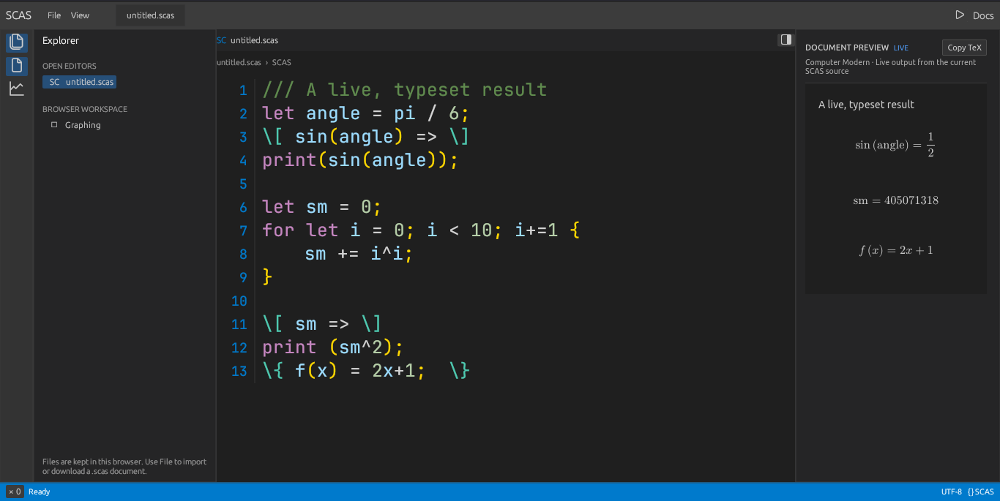

# SCAS



[Open the browser playground](https://starless333.github.io/scas/) · [Read the exact arithmetic design note](docs/exact-approximate-boundary.md)

SCAS is a Rust-based scripting language and computer algebra system for exact mathematics. It combines arbitrary-size integers and rationals, symbolic expressions, calculus, linear algebra, plotting, and ordinary programming constructs such as functions, closures, arrays, and control flow.

SCAS files can also be mathematical documents. `///` lines add prose; explicit render blocks evaluate expressions and typeset their results in LaTeX:

```scas
/// Diagonalize a matrix using exact arithmetic.
let A = [4, 0; 1, 2];
\[
    characteristic_polynomial(A, lambda) =>
\]
\[
    eigenvectors(A) =>
\]
```

Run a program or build its LaTeX document:

```sh
cargo run -- examples/mit-18-06-session-22.scas
cargo run -- build examples/mit-18-06-session-22.scas
```

Run the native IDE, with an editor, live mathematical preview, Problems and Output panels, graphing calculator, REPL, and integrated terminal:

```sh
cargo run --features gui --bin scas-gui
```

Build the browser IDE (Rust `wasm32-unknown-unknown` target and matching `wasm-bindgen-cli` 0.2.100 required):

```sh
bash scripts/build-web.sh
python3 -m http.server --directory web
```

The browser build runs SCAS in a Web Worker and offers source editing, a live math preview, a persistent REPL, zoomable and pannable graphing, virtual file import/download, and shareable source links. The Pages URL above is configured but has not yet been verified from a public deployment.

Prebuilt releases are available on the [Releases page](https://github.com/starless333/scas/releases). Building from source requires Rust and Cargo. The IDE’s LaTeX preview uses `latex` and `dvipng` when installed and falls back to a structured renderer otherwise.

Documentation: [overview](docs/index.html) · [getting started](docs/getting-started.html) · [language](docs/language.html) · [mathematical documents](docs/documenter.html) · [math functions](docs/math-functions.html) · [IDE](docs/ide.html).

SCAS is licensed under [MIT](LICENSE).
